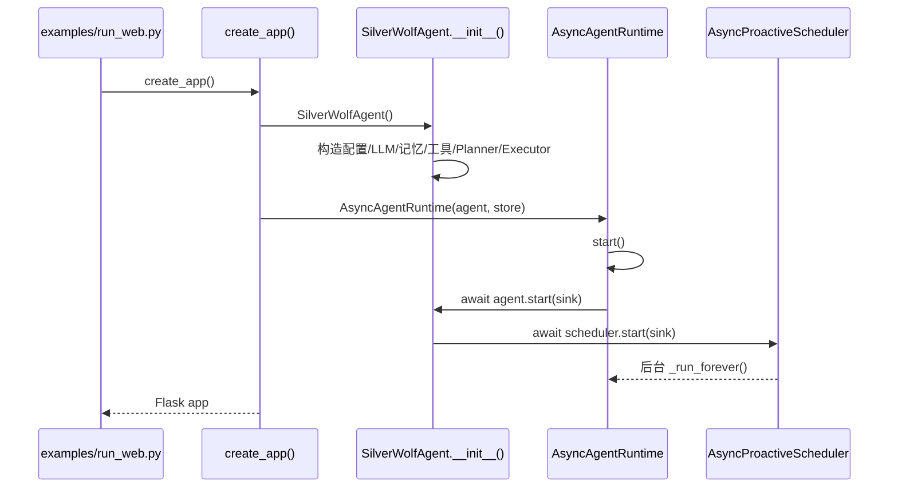
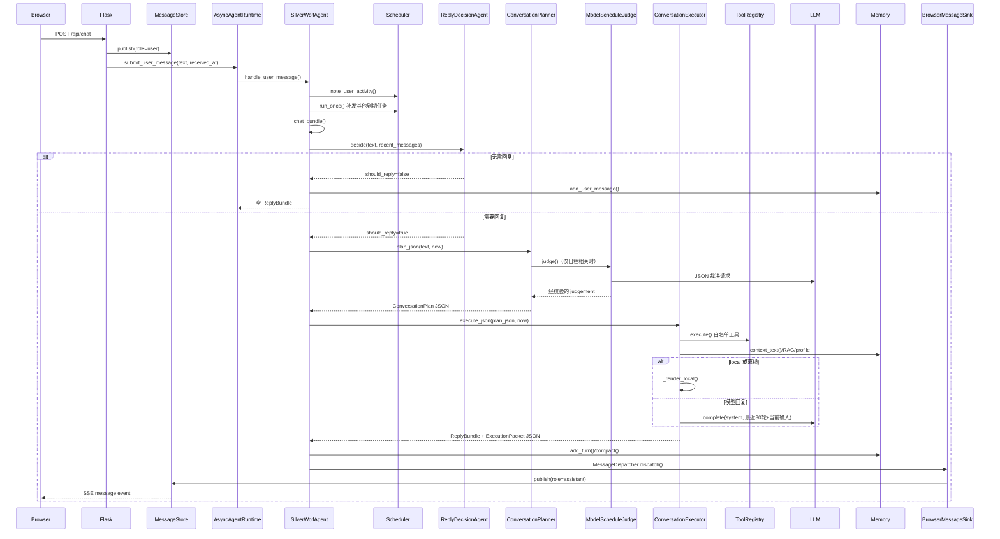
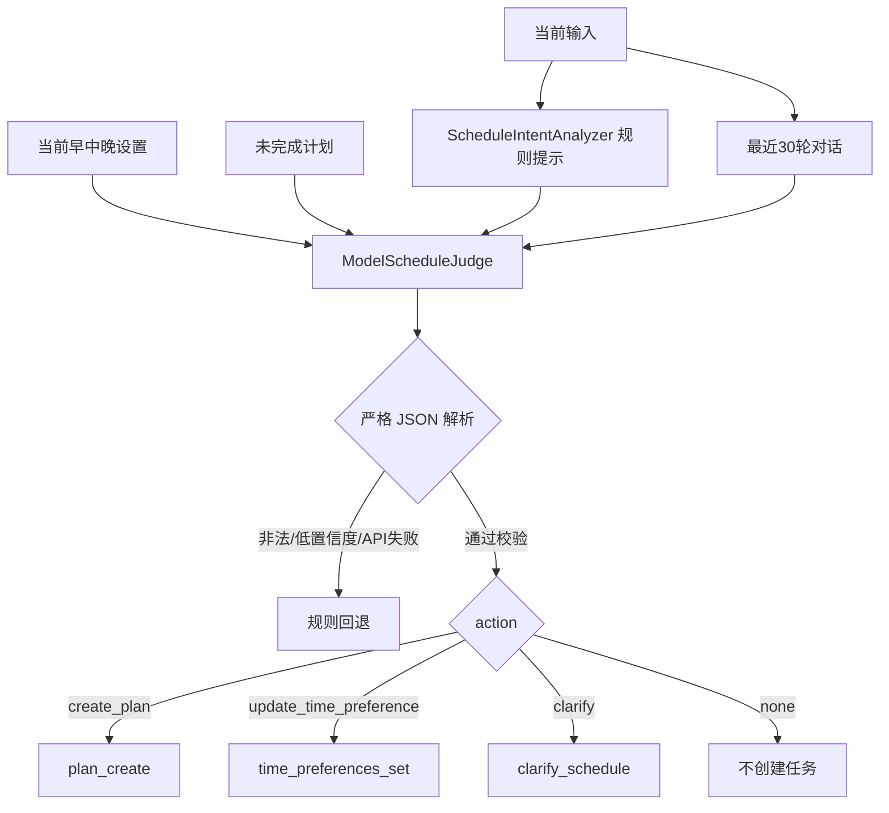
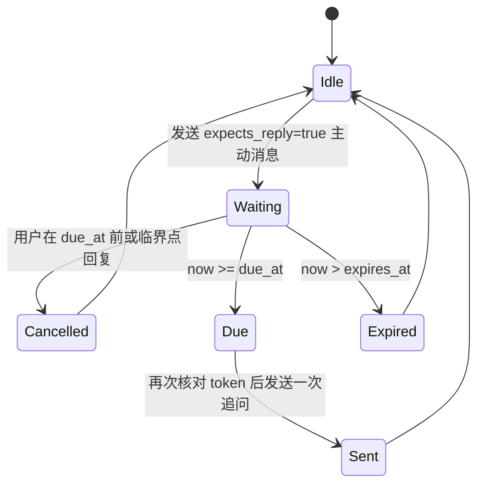
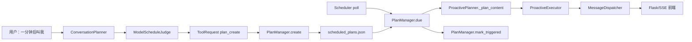
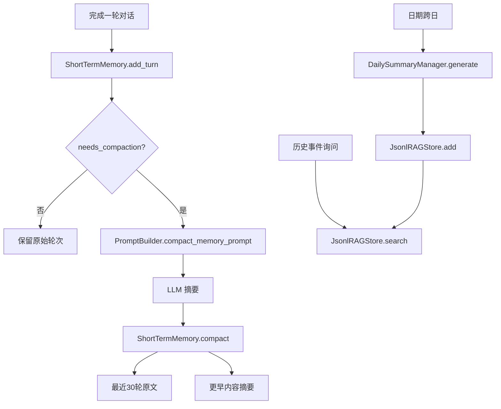
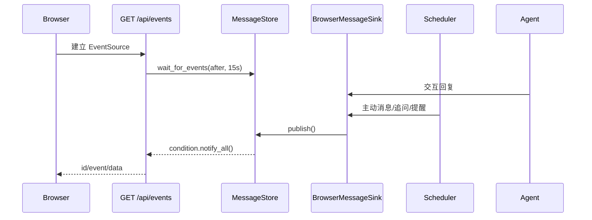

# 银狼 Lv21 函数调用流程

## 1. Web 启动流程



关键源码：

- `create_app()`：`silverwolf_agent/webapp/app.py`
- `AsyncAgentRuntime.start()`：`silverwolf_agent/webapp/runtime.py`
- `SilverWolfAgent.__init__()`：`silverwolf_agent/agent.py`
- `AsyncProactiveScheduler.start()`：`silverwolf_agent/proactive/scheduler.py`

## 2. 用户消息完整链路



关键入口：

- `SilverWolfAgent.handle_user_message()`：`silverwolf_agent/agent.py:522`
- `SilverWolfAgent.chat_bundle()`：`silverwolf_agent/agent.py:445`
- `ConversationPlanner.plan_json()`：`silverwolf_agent/pae/planner.py:1223`
- `ConversationExecutor.execute_json()`：`silverwolf_agent/pae/executor.py:87`
- `AsyncAgentRuntime.submit_user_message()`：`silverwolf_agent/webapp/runtime.py:158`
- `BrowserMessageSink.send()`：`silverwolf_agent/webapp/runtime.py:31`

## 3. 日程模型裁决链



本地校验包括：

- action 白名单；
- confidence 阈值；
- `HH:MM` 格式；
- due_at 必须在未来；
- 相对时间范围；
- recurrence 白名单；
- JSON 顶层必须为 object。

## 4. 日常主动关心链路

```mermaid
sequenceDiagram
    participant Loop as Scheduler._run_forever()
    participant Time as TimeManager
    participant State as ProactiveStateStore
    participant Planner as ProactivePlanner
    participant Library as ProactiveMessageLibrary
    participant Executor as ProactiveExecutor
    participant Dispatcher
    participant Sink
    participant Memory

    Loop->>Time: due_routines(now, state)
    Time-->>Loop: RoutineEvent[]
    Loop->>Planner: plan_json(now, routines, due_plans, follow_up)
    Planner->>Memory: recent_user_text(limit=30)
    Planner->>State: 读取 proactive_template_history
    Planner->>Library: select_routine()
    Library->>Library: 场景分组 + 排除最近模板 + 稳定散列
    Library-->>Planner: content/template_id/group/expects_reply
    Planner-->>Loop: ProactivePlan JSON
    Loop->>Executor: execute_json()
    Executor-->>Loop: ReplyBundle
    Loop->>Dispatcher: dispatch()
    Dispatcher->>Sink: send()
    Loop->>State: record_template_use()
    Loop->>State: mark_routine_sent()
    opt expects_reply
        Loop->>State: arm_follow_up(+120秒)
    end
    Loop->>Memory: add_proactive_message()
```

模板选择函数：

- `ProactivePlanner.plan_json()`：`silverwolf_agent/proactive/planner.py:69`
- `ProactiveMessageLibrary.select_routine()`：`silverwolf_agent/proactive/message_library.py:579`
- `ProactiveStateStore.record_template_use()`：`silverwolf_agent/proactive/state.py:581`

## 5. 两分钟未回复追问状态机



并发保护顺序：

1. `handle_user_message()` 先调用 `note_user_activity()`；
2. 然后才调用 `scheduler.run_once()`；
3. Planner 生成追问后，发送前调用 `is_follow_up_pending()` 再确认；
4. `arm_follow_up()` 还会检查 `last_user_activity_at`，防止跨线程迟写状态。

## 6. 一次性提醒执行链



## 7. 记忆、压缩与 RAG



## 8. Flask 与 SSE 消息链



## 9. 错误与回退

| 故障 | 处理 |
|---|---|
| 主模型 API 429/5xx | AnthropicCompatibleClient 重试与退避 |
| Planner 模型 API 失败 | ModelScheduleJudge 返回未接受，规则回退 |
| Planner JSON 非法 | 捕获解析/校验错误，规则回退 |
| Executor LLM 失败 | 使用本地渲染 |
| PromptBuilder 方法缺失 | 回归测试验证 `pae_executor_prompt` 在类内 |
| Scheduler 单轮异常 | 写入 `last_error`，后台循环继续 |
| proactive_state JSON 损坏 | 迁移/默认状态恢复 |
| pending follow-up 过期 | 标记 expired，不补发旧追问 |


## Lv19 日期与星期调用链

```text
用户问题 → ReplyDecisionAgent → TemporalQueryAnalyzer
→ ConversationPlanner(answer_calendar_query)
→ CalendarQueryTool → ConversationExecutor._calendar_answer
```


## Lv20 当前时间意图边界

```text
用户输入
  ↓
TemporalQueryAnalyzer._contains_current_clock_question
  ├─ 独立“当前几点”语义 → answer_current_time → time_now
  └─ “几点 + 睡/起/吃/出发/建议” → 普通对话/其他 Planner 语义
```

## Lv20 每日提醒确认

```text
用户：“以后你11点半叫我睡觉”
  ↓
ScheduleIntentAnalyzer
  ├─ 明确提醒
  ├─ 睡觉动作
  ├─ 11:30 + 睡觉语义 → 23:30
  └─ “以后” + 明确钟点 → recurrence=daily
  ↓
clean_schedule_title → “睡觉”
  ↓
plan_create
  ↓
ConversationExecutor.confirm_schedule
  ↓
“好啊，以后每天 23:30 我叫你睡觉……”
```

## Lv21 cognition 调用链

```text
chat_bundle
  -> ReplyDecisionAgent
  -> (silent) cognition.observe_silent_message + memory
  -> (reply) ConversationPlanner
       -> cognition.prepare_turn
          -> advance_offline
          -> observe user/shared reality/user model
          -> derive mood
          -> decide intent
       -> ConversationPlan.metadata.cognition_context
  -> ConversationExecutor
       -> ExecutionPacket.cognition_context
       -> local/LLM response
  -> cognition.record_assistant_reply
```

## Lv27 长期承诺调用链

```text
chat_bundle
  -> ReplyDecisionAgent
     └─ 静默且存在未完成澄清会话 → 强制 should_reply=True
        (category=commitment_clarification_pending)
  -> ConversationPlanner.plan
       -> cognition.prepare_turn
       -> CommitmentService.handle(text, now, alias)
            ├─ 有进行中的会话
            │    ├─ 用户取消 → mode=update（清会话）
            │    ├─ 含槽位信息 → 合并 → 补齐则确认，否则继续问
            │    └─ 无槽位信息 → mode=none（交回普通聊天，会话保留）
            ├─ 无会话且识别到长期承诺
            │    ├─ 参数不全 → 开会话 → mode=question
            │    └─ 参数齐全 → 建承诺 + 物化 → mode=confirm
            └─ 无会话且命中承诺操作 → 跳过/完成/改期/取消 → mode=update
       -> 承诺轮次把 schedule_decision 置为 should_persist=False
       -> goals += commitment_* 目标（render_mode=local, maximum_messages=1）
       -> metadata.commitment = {scene, facts, fallback_text, required_tokens}
  -> ConversationExecutor.execute_json
       -> _render_local → _render_goal → _render_commitment_goal
            -> SpeechComposer.compose(scene, facts, fallback, required_tokens)
                 ├─ 无模型/无语料 → deterministic
                 └─ 模型重写 → 五道护栏 → 通过则采用，否则回退
```

## Lv27 承诺到期链

```text
AsyncProactiveScheduler._run_once_unlocked
  -> delivery breaker 检查
  -> CommitmentService.sync_schedule(now)      # 补齐接下来的 occurrence
       -> PlanManager.create(metadata.kind=commitment_occurrence)
  -> PlanManager.due(now)
  -> ProactivePlanner.plan_json(due_plans=...)
       -> _render_due_content
            ├─ kind=commitment_occurrence → CommitmentService.plan_wording（带第 N/M 周）
            └─ 其他 → ReminderLanguage 确定性文案
  -> ProactiveExecutor → MessageDispatcher → Sink
  -> PlanManager.mark_triggered（一次性计划语义，无需改 recurrence）
```

## Lv28 记忆检索链

```text
ConversationPlan.memory_request.use_rag
  -> ConversationExecutor._retrieve_rag(plan, now)
       -> JsonlRAGStore.search_scored(query, top_k=4, now)
            relevance = 词法（uni/bi-gram 重叠，Lv27 公式）
            importance_norm = (importance - 1) / 9
            S = 14 + 6*importance + 4*min(recall_count, 5)
            recency = exp(-age_days / S)
            final = 0.55*relevance + 0.25*importance_norm + 0.20*recency
       -> mark_recalled(doc_ids, now)     # 命中即记一次复习
       -> 渲染成 "[日期｜重要度N] 文本" 注入 ExecutionPacket.rag_context
```

## Lv28 每周反思链

```text
chat_bundle / run_proactive_once
  -> agent.maybe_reflect(now)
       -> ReflectionEngine.due(now)
            ├─ 今天已经跑过 → 不跑
            ├─ 周日且已过 21 点 → "weekly"
            └─ 本周重要度合计 ≥ 150 → "threshold"
       -> ReflectionEngine.run(now)
            -> 取证：本周 topN 高重要度 RAG + 未完成承诺
            -> 生成：模型严格 JSON（无模型则统计式）
            -> 护栏：证据必须真实存在 / 禁词过滤 / 置信度封顶 0.65
            -> CognitiveStateManager.record_reflection()
                 ├─ reflections（保留 12 条）
                 ├─ user_model.beliefs（source=reflection，仅在 llm 模式）
                 └─ shared_reality.milestones
            -> JsonlRAGStore.add(kind="reflection", importance=8)
       反思结果不进 ReplyBundle，永不主动播报。
```

## Lv28 沉默回归链

```text
ProactivePlanner.plan_json
  -> _silence_hours(now) = now - proactive_state.last_user_activity_at
  -> silence_return = silence_hours >= SILVERWOLF_SILENCE_RETURN_HOURS
  -> _open_threads()（活跃长期承诺标题）
  -> ContextualCareComposer.compose(silence_return=..., open_threads=...)
       ├─ 命中：用 silence_continuation() 替换例行问候
       │    未完成承诺 → 「上次说的「X」，这几天动过一点吗？」
       │    否则 → 话题回忆（memory_callback）
       └─ 未命中：行为与 Lv27 完全一致
  正式提醒（承诺 occurrence / 吃药 / 睡觉）走 _render_due_content，不经过这里。
```
