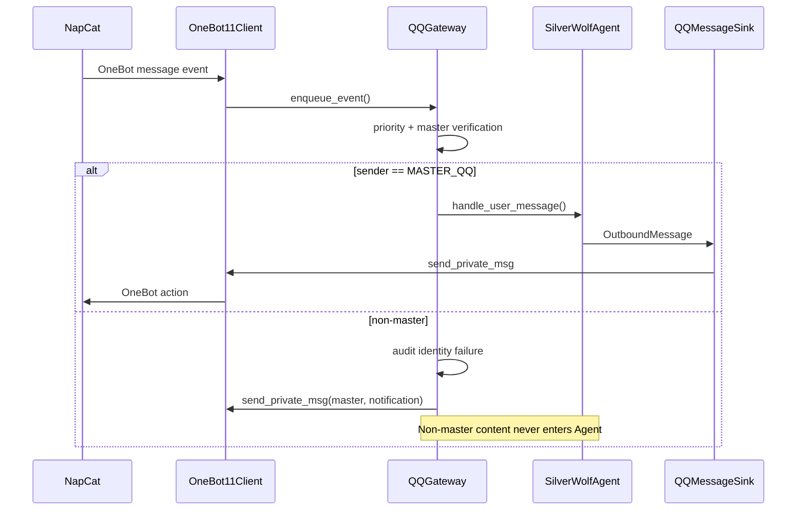
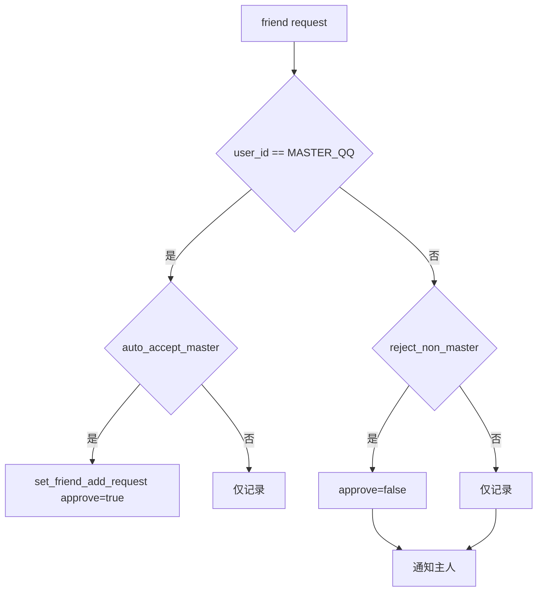

# 银狼 lv16：QQ 适配器架构与安全边界

## 模块结构

```text
silverwolf_agent/qq/
├─ config.py
├─ events.py
├─ audit.py
├─ onebot.py
├─ sink.py
├─ gateway.py
└─ __init__.py
```

## 调用链



## 主人优先级

事件队列优先级：

| 优先级 | 事件 |
|---:|---|
| 0 | 主人消息 |
| 1 | 主人好友申请 |
| 10 | OneBot 生命周期 |
| 20 | 非主人请求 |
| 30 | 非主人消息 |
| 50 | 其它事件 |

单个正在处理的模型请求不会被强制中断，但队列中的主人事件会排在所有非主人事件之前。

## 好友申请状态



## 非主人消息边界

非主人消息只允许进入：

```text
QQMessageEvent
QQAuditLogger
主人通知格式化
send_private_msg(master)
```

不允许进入：

```text
SilverWolfAgent.handle_user_message
ConversationPlanner
DeepSeek API
ShortTermMemory
RAG
UserProfile
Proactive follow-up
```

## OneBot 动作关联

`OneBot11Client.call_action()` 使用 UUID `echo`：

```text
发送：
{
  "action": "get_login_info",
  "params": {},
  "echo": "uuid"
}

接收：
{
  "status": "ok",
  "retcode": 0,
  "data": {...},
  "echo": "uuid"
}
```

接收循环通过 `echo` 解析动作响应；没有 `echo` 的 JSON 作为事件交给 `QQGateway`。

## 重连

```text
初始等待 2 秒
→ 4 秒
→ 8 秒
→ ...
→ 最大 30 秒
```

重连期间：

- 主动消息发送会等待连接恢复；
- 未完成动作 Future 会收到断开异常；
- Agent 的主动 Scheduler 不会退出；
- lifecycle reconnect 后刷新机器人账号信息。

## 紧急关闭

条件必须同时满足：

```text
sender.user_id == MASTER_QQ
消息前缀 == QQ_EMERGENCY_COMMAND
token == QQ_EMERGENCY_TOKEN
```

失败只记录：

```text
emergency_shutdown_auth_failed
```

成功：

```text
停止 Agent Scheduler
关闭 OneBot WebSocket
停止事件 Worker
退出 run_forever
```

## 已知限制

- QQ 登录不是由 Python Agent 直接实现，而由 NapCat 等协议端完成。
- 当前仅处理文本和消息段占位符，不下载图片或语音。
- 群聊默认关闭。
- message_id 去重是进程内缓存，重启后清空。
- 事件队列不会中断已经开始的 DeepSeek 请求。
- OneBot 实现的扩展字段可能不同，标准字段之外采取容错读取。
- 没有真实 QQ/NapCat 环境时，自动测试使用 FakeOneBotClient。
